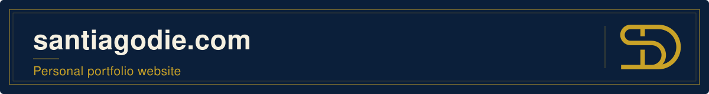

<p align="center"></p>

<p align="center">The source of <a href="https://santiagodie.com">santiagodie.com</a>: a one-page portfolio in English, Spanish and French, generated as static HTML (one page per language) from JSON content by a small Python script. No framework, no runtime dependencies.</p>

<p align="center">
  
  <a href="https://santiagodie.com"></a>
</p>

## Table of Contents

- [About the Project](#about-the-project)
- [Built With](#built-with)
- [Getting Started](#getting-started)
- [Project Structure](#project-structure)
- [Adding a Project](#adding-a-project)
- [Editing or Adding a Translation](#editing-or-adding-a-translation)
- [Deployment](#deployment)
- [Contact](#contact)

## About the Project

- **One static page per language**, for search engines: English at `/`, Spanish at `/es/`, French at `/fr/`. Every word is in the generated HTML; JavaScript only adds behaviour (header state, menus, a dismissible language suggestion) and never injects content.
- **Sections**: About (the chat), Projects, Experience, Education (with Certifications), Skills (with spoken Languages) and Contact, numbered 01–06.
- **Navigation**: on desktop, a sticky bar with the profiles and a language menu shown as flags (inline SVG, each language named in its own language). Below 64em, a full-screen menu (a modal dialog with the sections and their numbers, the profiles and the languages); without JavaScript the links simply sit in the header.
- **SEO per language**: translated `title`, description and Open Graph, `<link rel="canonical">`, `hreflang` alternates (with `x-default` to English), a Person JSON-LD block (education, languages, location, email, profiles; the internship as `affiliation`, not `worksFor`), `sitemap.xml` and `robots.txt`. There is no automatic redirect by browser language.
- **Content lives in JSON**: interface text and personal content in `i18n/<lang>.json`, projects (with their three languages) in `data/projects.json`, shared data (profiles, email, address, schools) in `data/site.json`. The build fails with a clear message if any language misses a key, so a page with gaps is never published.
- **Unpublished placeholders**: paragraphs and entries that start with `TODO` stay in `i18n/*.json` but are not published. A section left without content is left out with its menu link and its point on the progress line, and the other sections are renumbered 01, 02, 03... without gaps; it comes back by itself once it has content. Contact always shows the email, GitHub, LinkedIn and the location; the CV appears once the PDF exists.
- **Email**: a plain `mailto:` link, written in the HTML as character entities (and as Unicode escapes in the JSON-LD), so it reads and works the same with or without JavaScript but is not in the source as plain text for simple scrapers.
- **The About chat**: the About section (01) introduces Santiago through a chat. Once the section has assembled, the question "Who is Santiago Die?" (translated per page) types itself into the box. Press send and the camera zooms into the message: it splits into tokens with their real ids (`cl100k_base`), each unfolds a vector, attention arcs and a pulse run through the layers, the candidates for the next token share out the probability, and the winner flies into the answer. The next few tokens flash through the cycle, then the rest of the answer (three paragraphs) streams in word by word, finished about 5 s after the camera pulls out. Then a notice says the chat has hit its message limit, with the reset time in the visitor's local time, and links to Contact to ask Santiago directly; the box switches off. About 18 s, with Skip (or Escape) and Replay; it pauses in a hidden tab and finishes itself if scrolled away. The panel is as tall as the finished chat from the start, so nothing on the page moves; on short or narrow screens the conversation scrolls inside the panel and follows the text as it streams. Embeddings, attention weights and probabilities are illustrative. Without JavaScript the chat is shown answered, with the notice (without a time); with reduced motion the answer and the notice fade in without zoom or stages.
- **Projects**: the three featured projects in a row of cards with their README metrics; the others in small cards (title, course, technologies), each one link to its repository, with a separate Demo link where there is one.
- **Scroll**: sections assemble once as they arrive, and a thin gold line drawn with the scroll links the section numbers (CSS scroll timeline where supported, `requestAnimationFrame` elsewhere). Content is always visible in the HTML; nothing holds or redirects the scroll.

## Built With

- HTML, CSS and vanilla JavaScript
- Python 3 (standard library only) for the generator
- [Hubot Sans](https://github.com/github/hubot-sans), [Mona Sans](https://github.com/github/mona-sans) and [JetBrains Mono](https://github.com/JetBrains/JetBrainsMono), self-hosted in `fonts/` (SIL Open Font License; variable woff2 cut to the weights and widths in use and subset to Latin and Latin Extended)
- GitHub Actions and GitHub Pages

## Getting Started

Build the three pages into `dist/` and serve them locally:

```bash
python tools/build.py --serve
```

Then open <http://localhost:8000> (and `/es/`, `/fr/`). Use `python tools/build.py` to build without serving, or `--port 8080` to change the port. `dist/` is generated, ignored by git and rebuilt by the deployment workflow.

## Project Structure

```
src/index.html             # Page template ({{ key }} placeholders, see tools/build.py)
i18n/en.json, es.json, fr.json   # All copy, per language
data/projects.json         # Projects: titles, subjects, descriptions, metrics, links (3 languages)
data/site.json             # Site URL, languages, and the person: email, profiles, address, schools (JSON-LD)
data/tokens.json           # Real cl100k_base token ids of the About chat's question and answer
data/llm.json              # Illustrative values of the About chat: attention weights, next-token candidates
css/styles.css             # All styles: tokens, layout, components, motion
js/main.js                 # Behaviour only: header, the full-screen mobile menu (dialog, focus), language menu, language suggestion
js/chat.js                 # Plays the About chat (Web Animations; the text is already in the HTML)
js/scroll.js               # Progress line, current section, sections assembling on scroll
img/                       # SD logos (unmodified)
fonts/                     # Hubot Sans, Mona Sans, JetBrains Mono (woff2 subsets) with their OFL licences
favicon.svg, favicon.ico, apple-touch-icon.png, CNAME
og-image.png, og-image-es.png, og-image-fr.png   # Link previews, one per language
tools/build.py             # Generator: renders dist/, sitemap.xml and robots.txt
DESIGN.md, PRODUCT.md      # Design system and product context, owner's rules included
tools/tokenize.py          # Local only (pip install tiktoken): regenerates data/tokens.json; not used by the workflow
.github/workflows/pages.yml  # Builds and deploys dist/ on every push to main

assets/banner.svg          # README banner (not published)
```

## Adding a Project

Add an object to `data/projects.json`. Cards appear in the order of the list.

```json
{
  "id": "my-project",
  "title": { "en": "My Project", "es": "Mi proyecto", "fr": "Mon projet" },
  "subject": { "en": "Artificial Intelligence", "es": "Inteligencia Artificial", "fr": "Intelligence artificielle" },
  "featured": false,
  "description": { "en": "One or two sentences.", "es": "…", "fr": "…" },
  "todo": [],
  "tech": ["Python", "PyTorch"],
  "repo": "https://github.com/santiagodie/my-project",
  "demo": { "url": "https://santiagodie.com/my-project/", "type": "web" }
}
```

- `title`, `description`, `subject` (the university course, from the README's "Built for the … course" line) and the metric labels are required in every language; the build stops if one is missing. The repository name is not translated: it is shown in mono on the card.
- `demo` is optional; use `"type": "colab"` for a notebook. On small cards it becomes a small "Demo" (or "Colab") link of its own beside the card's link to the repository.
- A project split across several repositories keeps the main one in `repo`, names its link with `repoLabel` (`{en, es, fr}`, instead of "Code") and lists the others in `repos`: `[{ "url": "…", "label": { "en": "Web client", "es": "Cliente web", "fr": "Client web" } }]`. On small cards the main repository's name gets its own line and the extra links sit below it, next to the demo.
- `todo` lists what is still pending. While it contains `description.es` or `description.fr`, that page shows a "translate description" marker and marks the English text with `lang="en"`.
- **Featured projects** (`"featured": true`) sit in the top row, three across on desktop, with their description and `metrics`: one or two `{ "value": {en, es, fr}, "label": {en, es, fr} }` taken from the README (format numbers per language: `4,122` / `4.122` / `4 122`). The other projects get small cards, four across, without the description (keep writing it: it is used if the project becomes featured).

## Editing or Adding a Translation

- Edit the same key in the three files in `i18n/`. Lists must have the same entries in every language; an entry whose title still starts with `TODO` is not published, and a section with nothing to publish is left out:
  - `experience.items`: `period`, `title`, `org`, `place`, `text` and `stack` (technologies separated by ` · `, shown in mono);
  - `education.items`: `period`, `title`, `org`, `text` (may be empty) and `details` (the line of subjects or track); `education.certifications` is the list under it;
  - `skills.groups`: a `name` and its `items` (generic terms translated, technology names not); `skills.languages` lists the spoken languages with their level.
- `about.paragraphs` is optional text under the About chat (empty today: the chat's answer says it). The email, the address and the schools are in `data/site.json`; `contact.location` is the location shown in Contact.
- The About chat's question and answer are `chat.prompt` and `chat.answer` (paragraphs separated by a blank line, `\n\n`); the message-limit notice is `chat.limit` (`{time}` marks the reset time, and `resetOne` is the form for one o'clock, "a la 1:00" in Spanish). After editing them, run `python tools/tokenize.py` to re-encode both with the `cl100k_base` tokenizer into `data/tokens.json` (it needs `pip install tiktoken` and only runs locally; the GitHub workflow does not use it); the build refuses ids that no longer spell the text. In `data/llm.json`, keep one attention weight per question token and start `next` with the first answer token (the other candidates and the probabilities are illustrative).
- To add the CV, put the PDF in a `cv/` folder (it is copied into `dist/`) and set `contact.cvFile`, for example `"cv/santiago-die-morejon-cv.pdf"`, in each language file; until the file exists, there is no CV button.
- To add a language: copy `i18n/en.json` to `i18n/<code>.json` and translate it, add every project's `<code>` texts, add `{ "code": "<code>", "path": "<code>/" }` to `languages` in `data/site.json`, add its tokens to `data/tokens.json` and its attention weights and candidates to `data/llm.json`. The menu, hreflang links and sitemap appear automatically; for the language suggestion bar add the `html[data-suggest="<code>"]` line in `css/styles.css`, and for its link preview add an `og-image-<code>.png` (1200×630).

## Deployment

Every push to `main` (or a manual run) triggers `.github/workflows/pages.yml`: it runs `python tools/build.py` and deploys only `dist/` to GitHub Pages. In the repository settings, **Pages → Build and deployment → Source** must be **GitHub Actions**; the custom domain stays configured through `CNAME`.

## Contact

Santiago Die · [Email](mailto:contact@santiagodie.com) · [GitHub](https://github.com/santiagodie) · [LinkedIn](https://www.linkedin.com/in/santiago-die-morejon)
